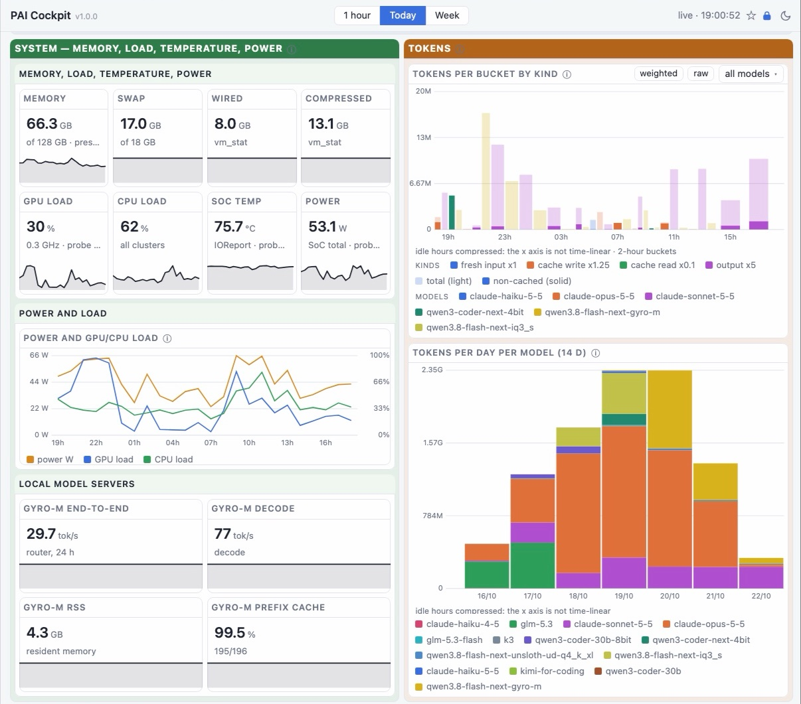
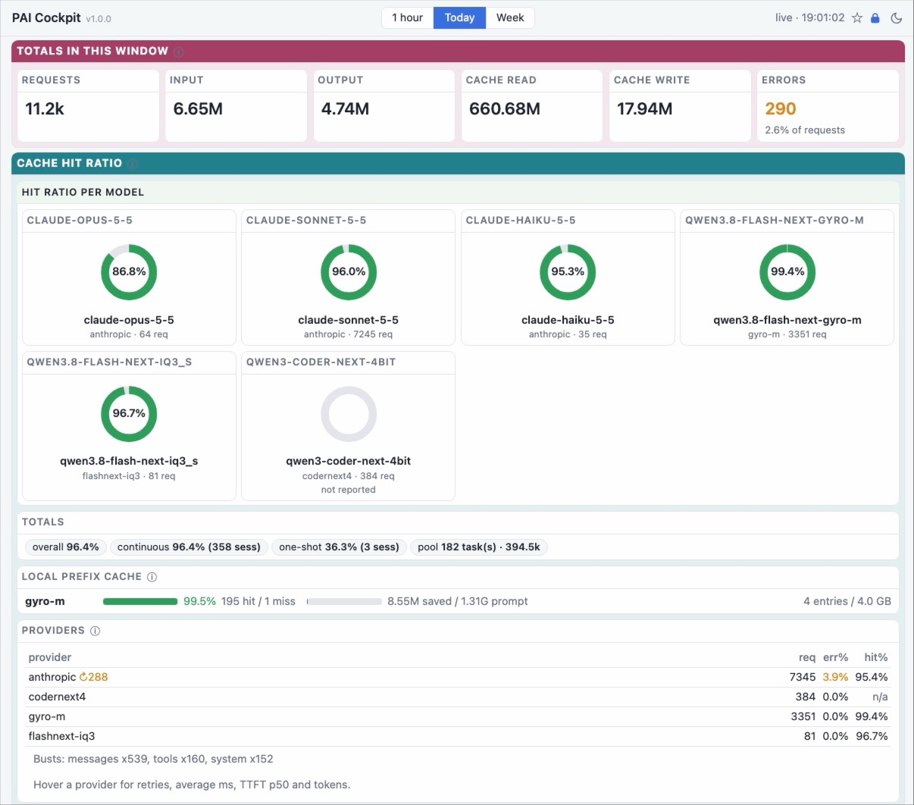
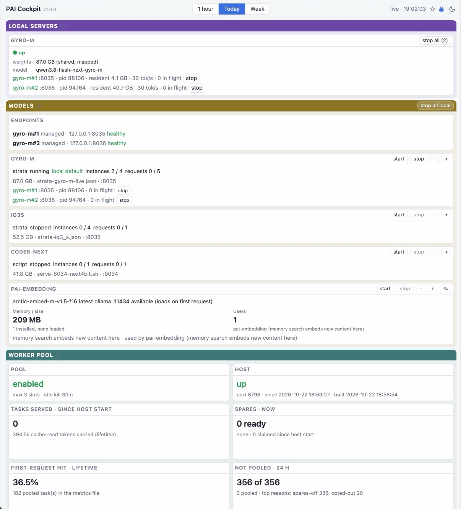
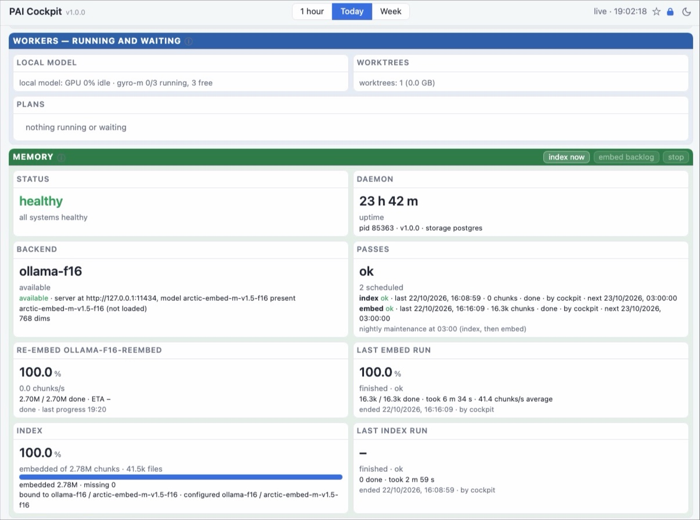
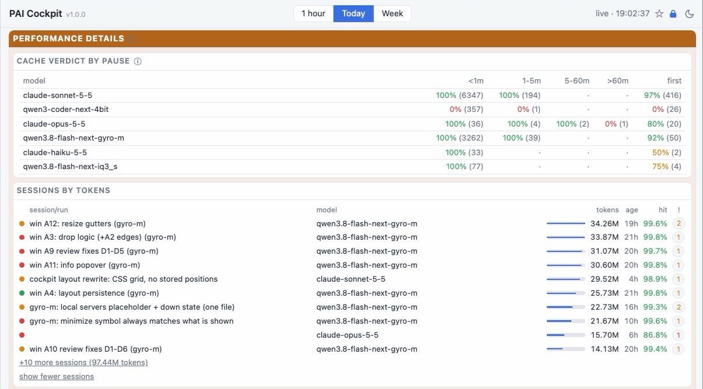
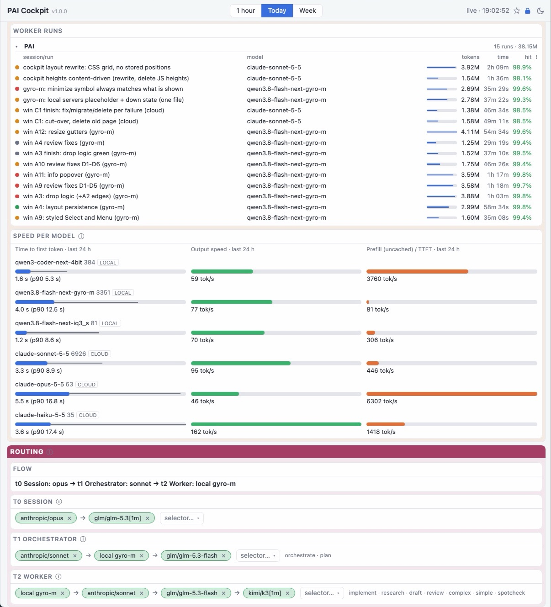
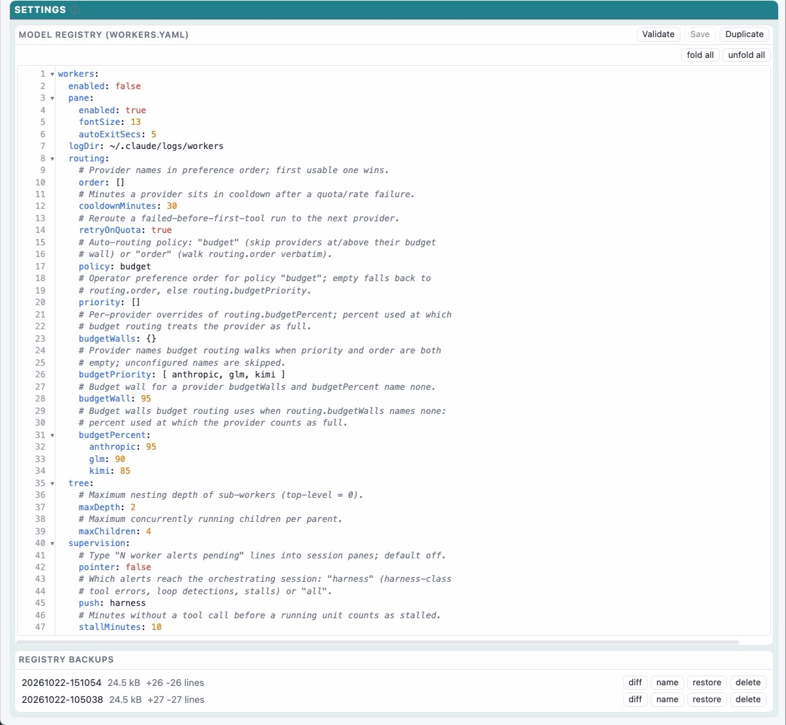

# PAI Knowledge OS

**One Claude Code chat is one model, one budget and no memory. PAI turns it into a team: it remembers, it routes every job to the right model, cloud or local, and it shows you all of it live.**

You burn your premium tokens on work a local model could do. You hit the weekly limit on a Tuesday. Every new session starts from zero. PAI fixes all three:

- **Model routing, cloud and local.** One router sits in front of every model you have: Anthropic, other cloud providers, and the models running on your own machine. `/model` switches between them mid-session, and when one provider's budget runs out, the next one takes over.
- **A hierarchy that spends tokens where they matter.** Three tiers: `t0` the session you talk to, `t1` the orchestrator that plans and reviews, `t2` the workers that implement. Workers go local first, because local tokens are free. Cloud comes first only where it earns its price: wide context and real reasoning. Every worker runs in its own visible pane and git worktree; you review the diff, PAI merges it.
- **A live cockpit.** One page shows your token budget per provider, cache hits, every model and local server with start and stop buttons, running workers, routing per tier, and memory and embedding progress. Drag the cards into the layout you want.
- **Memory underneath it all.** Every session writes its own notes in the background, searchable across sessions, projects and your notes vault, by keyword, meaning or both. Everything stays on your machine.

### Local AI used to be hard. Now it is a button.

I have spent a long time on local AI. Getting a strong model to run on my own machine was the easy part; making it actually useful was not. Which server, which quantization, which port, how to keep it alive, how to send it only the work it can do, and how to fall back to the cloud when it cannot. Every piece worked on its own and none of them worked together.

PAI is what came out of that, and I am giving it to the community. A MacBook can already run a serious model: on mine, [Strata](https://github.com/Niko1221/Strata) serves [Qwen3.8-Flash-Next](https://huggingface.co/Qwen/Qwen3.8-Flash-Next) in its compact [Gyro-M](https://huggingface.co/agentionai/Qwen3.8-Flash-Next-Gyro-GGUF) quantization, and PAI turns that into a worker like any other. Start it from the cockpit, and PAI routes worker jobs to it automatically, shows its speed and cache live, and hands a job to the cloud only when it needs a wider context or deeper reasoning than the local model has. You stop thinking about local AI. It just takes its share of the work.

`pai` starts or resumes a session in the current project. `pai pause` and `pai end` save your place. Memory works on its own; the router, workers and cockpit join when you want them. Terms are explained in the [glossary](docs/README.md#words-used-in-these-docs).

**Install it in two lines inside Claude Code, then say "set up PAI".** [Jump to install](#install).















*The router cockpit (`http://127.0.0.1:8790/cockpit`). See [the cockpit page](docs/cockpit.md).*

## Install

Prerequisites: [Claude Code](https://claude.com/claude-code) and Node.js 20 or newer. Docker is only needed for the optional PostgreSQL storage (semantic search); the default sqlite needs nothing.

Inside Claude Code, add this repository as a plugin marketplace and install the `pai` plugin:

```
/plugin marketplace add mnott/PAI
/plugin install pai@pai
```

Then say **"set up PAI"**. `/plugin` lists `pai` once it is installed. The skill checks each phase first and does only what is missing, and ends with a pass/fail list of its checks.

Without the plugin, from a clone, or for a one-session plugin load: [docs/install/index.md](docs/install/index.md). Memory works as soon as setup is done; workers are optional ([First workers](docs/install/first-workers.md)).

## Where to go next

### Install

[Install](docs/install/index.md) · [First workers](docs/install/first-workers.md)

### Concepts

[Workers](docs/concepts/workers.md) · [delegation tiers](docs/concepts/delegation-tiers.md) · [panes](docs/concepts/panes.md) · [providers](docs/concepts/providers.md), and the rest in [docs/README.md](docs/README.md).

### Cockpit

[The cockpit page](docs/cockpit.md): sections, aliases, layout.

### Reference

[Configuration](docs/config.md) · [Config defaults](docs/config-defaults.md) · [Commands](docs/commands/README.md) (generated from the CLI: `pai help`, `pai more`, `pai help <command>`)

The full index, including memory, search and developer docs, is [docs/README.md](docs/README.md).

## Daily use

```bash
pai                 # picker: newest sessions first, type to filter, Enter opens
pai NAME            # open a session by name
pai ls              # the same list as a plain table
pai more            # every other command, grouped
pai help <command>  # full help for one command
```

`pai pause` saves your place before you leave a session and `pai end` finishes it.

## Acknowledgments

Inspired by Daniel Miessler's Personal AI Infrastructure, claude-mem, Cognee and PageIndex. Full credit and links: [docs/README.md](docs/README.md#acknowledgments).

## License

MIT
