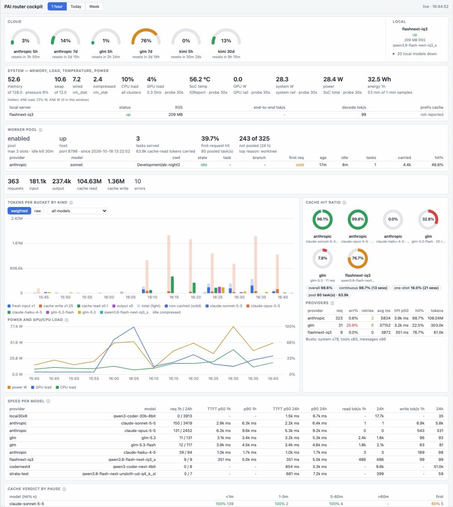

# PAI Knowledge OS

Claude Code has a memory problem. Every new session starts cold — no idea what you built yesterday, what decisions you made, or where you left off. PAI fixes this.

Install PAI and Claude remembers. Ask it what you were working on, find that conversation about the database schema, or pick up exactly where the last session ended.

- Automatic session notes, split by topic, written by a background daemon
- Federated keyword and semantic search across sessions, notes and vaults
- Workers on any provider, orchestrated from one Claude Code session
- Delegation tiers: session, orchestrator, workers with a local model first ([guide](docs/concepts/delegation-tiers.md))
- Everything runs locally



*The router cockpit (`http://127.0.0.1:8790/cockpit`): provider limits, local servers, memory and power, the worker pool, token and cache accounting, speed per model. See [the cockpit section](docs/three-tier-coding.md#the-cockpit).*

## Install

> **The easy way, on macOS and Linux:** open Claude Code and say
>
> **"Clone https://github.com/mnott/PAI and set it up for me"**
>
> Claude installs PAI, runs the setup wizard and checks the daemon.

**Prerequisites:** [Claude Code](https://claude.com/claude-code), Node.js 20 or newer, and Docker if you choose PostgreSQL.

By hand, the same on macOS and Linux:

```bash
npm i -g @tekmidian/pai
pai setup --yes --storage postgres   # keyword + semantic search (pgvector in Docker); or: --storage sqlite
pai daemon status                    # should show "running"
```

`pai setup` without `--yes` asks every question interactively. It installs the daemon as a LaunchAgent on macOS and a systemd user service on Linux. From a source checkout: `git clone https://github.com/mnott/PAI && cd PAI && bun install && bun run build`.

→ [docs/install/index.md](docs/install/index.md) (install skill, both storage paths, Docker, systemd) · [docs/install/first-workers.md](docs/install/first-workers.md)

## Daily Use: the `pai` command

The everyday job is: find a session, start it, make sure it runs where you want.

```bash
pai                 # picker: newest sessions first, type to filter, Enter opens
pai NAME            # open a session by name; shows how it will start (Enter = exactly like last time)
pai ls              # the same list as a plain table
pai setups          # orchestrator + worker combinations you can start a session with (local models included)
pai new ~/code/app --with "anthropic + flashnext-iq3 workers"   # new folder: Anthropic plans, the local model codes
pai more            # every other command, grouped (memory, workers, daemon, ...)
pai help <command>  # full help for one command, e.g. pai help worker
```

`pai pause` saves your place before you leave a session and `pai end` finishes it. Everything else (`pai memory`, `pai worker`, `pai project`, `pai daemon`, ...) is listed by `pai more`; the names that hooks, skills and MCP tools call did not change.

## Command Reference

Every `pai` command has a page generated from the live CLI: `pai help`, `pai more`, `pai help memory`, `pai memory --help`.

→ [docs/command-reference.md](docs/command-reference.md) · [docs/commands/](docs/commands/README.md)

## Worker Providers

Work is delegated over three tiers: the session you talk to (t0), an orchestrator that splits and plans (t1), and workers that implement (t2, local model first). Each tier has an ordered model list in `workers.yaml`; `pai worker route` prints it. See [docs/concepts/delegation-tiers.md](docs/concepts/delegation-tiers.md).

Large coding jobs, with loop guards, time limits and a cockpit: [docs/three-tier-coding.md](docs/three-tier-coding.md). Concepts: [workers](docs/concepts/workers.md) · [providers](docs/concepts/providers.md) · [routing policy](docs/concepts/routing-policy.md) · [escalation](docs/concepts/escalation.md) · [session profiles](docs/concepts/session-profiles.md).

→ [docs/concepts/providers.md](docs/concepts/providers.md) · [docs/worker.md](docs/worker.md) · [docs/workers-config.md](docs/workers-config.md) · [docs/provider-independence.md](docs/provider-independence.md)

Per-project worker setup (`pai project init`, checks in `pai project health`):
[docs/worker-project-setup.md](docs/worker-project-setup.md) · [panes](docs/worker-panes.md) · [pane footer and long jobs](docs/worker-pane-footer.md) · [snapshots](docs/worker-snapshots.md) · [`.pai/worker.md`](docs/worker-rules.md) · [status sink](docs/project-status-sink.md) · [issue claims](docs/issue-claims.md) · [hook denials](docs/worker-denials.md)

## Automatic Session Notes

A background daemon documents every session as it happens, from the transcript and git history, and starts a new note when the topic changes.

→ [docs/session-notes.md](docs/session-notes.md)

## What You Can Ask Claude

Search your memory, manage projects, navigate sessions, review your week, keep things safe, work with Obsidian and manage your budget, all in plain language.

→ [docs/what-you-can-ask.md](docs/what-you-can-ask.md)

## Skills

On-demand skills for productivity, session management, Obsidian vaults and system tools.

→ [docs/skills.md](docs/skills.md)

## Budget-Aware Advisor Mode

Adapts how much work Claude delegates to cheaper models as your usage limits fill up, with thresholds and a statusline label.

→ [docs/budget-advisor.md](docs/budget-advisor.md)

## Context Preservation

State is saved before compaction and injected afterwards, so a compaction, a restart or a crash does not cost you the thread.

→ [docs/context-preservation.md](docs/context-preservation.md)

## Session Management

One entry point, `pai <topic>`: an interactive picker over projects and sessions, topic search, pausing all sessions at once.

→ [docs/session-management.md](docs/session-management.md)

## Memory

Progressive memory loading in four layers, a temporal knowledge graph, and a three-tier hybrid store with graph-completion search and a relevance feedback loop.

→ [docs/memory.md](docs/memory.md)

## Automatic Observation Capture

Tool calls are classified into structured observations and injected back as progressive context.

→ [docs/observations.md](docs/observations.md)

## Whisper Rules and Privacy Tags

Rules injected into every prompt so they survive compaction, and `<private>` tags that keep content out of the index.

→ [docs/rules-and-privacy.md](docs/rules-and-privacy.md)

## Search

Keyword, semantic and hybrid search with cross-encoder reranking, recency boost, a compact token-efficient format and section-aware retrieval.

→ [docs/search.md](docs/search.md)

## Auto-Compact Context Window

The durable way to make Claude Code compact automatically, via `CLAUDE_AUTOCOMPACT_PCT_OVERRIDE`.

→ [docs/auto-compact.md](docs/auto-compact.md)

## Zettelkasten Intelligence

Graph operations over your Obsidian vault: connections, themes, god notes, communities, latent ideas.

→ [docs/zettelkasten.md](docs/zettelkasten.md)

## How It Works

Storage options (SQLite or PostgreSQL + pgvector), prerequisites and the indexing loop. Deep dive: [ARCHITECTURE.md](ARCHITECTURE.md).

→ [docs/how-it-works.md](docs/how-it-works.md)

## Use Cases

Solo developer, team lead, researcher: what changes with persistent memory.

→ [docs/use-cases.md](docs/use-cases.md)

## Release History

→ [docs/release-history.md](docs/release-history.md) · [CHANGELOG.md](CHANGELOG.md)

## Companion Projects

AIBroker, Whazaa, Telex, Coogle and DEVONthink MCP.

→ [docs/companion-projects.md](docs/companion-projects.md)

## Acknowledgments

PAI Knowledge OS is inspired by [Daniel Miessler](https://github.com/danielmiessler)'s concept of Personal AI Infrastructure and his [Fabric](https://github.com/danielmiessler/fabric) project — a Python CLI for augmenting human capabilities with reusable AI prompt patterns. Fabric is excellent and solves a different problem; PAI takes the same philosophy in a different direction: persistent memory, session continuity, and deep Claude Code integration. See [FEATURE.md](FEATURE.md) for a detailed comparison.

The automatic observation capture system — classifying tool calls into structured observations with progressive context injection — is inspired by [claude-mem](https://github.com/thedotmack/claude-mem) by [thedotmack](https://github.com/thedotmack). claude-mem demonstrated that automatic memory capture during Claude Code sessions dramatically improves continuity. PAI adapts this concept with a rule-based classifier, PostgreSQL storage, and three-layer progressive disclosure.

The three-store hybrid memory architecture — combining SQLite/PostgreSQL chunks with a knowledge graph and vector embeddings, graph-completion search (vector seeds → graph traversal → re-rank), and the feedback EMA relevance loop — is inspired by [Cognee](https://github.com/topoteretes/cognee) by [topoteretes](https://github.com/topoteretes). Cognee showed that unifying structured knowledge graphs with unstructured vector retrieval produces dramatically better recall. PAI adapts this pattern to the personal knowledge OS context with project-scoped multi-tenancy and content-address entity deduplication.

Section-aware retrieval (heading paths on chunks, `memory_outline`) borrows from [PageIndex](https://github.com/VectifyAI/PageIndex) by [VectifyAI](https://github.com/VectifyAI), which retrieves from long documents by navigating a heading tree rather than by similarity alone. PAI keeps its keyword, vector and graph search and adds the tree as structure the model can navigate, without an LLM call per query.

## License

MIT
