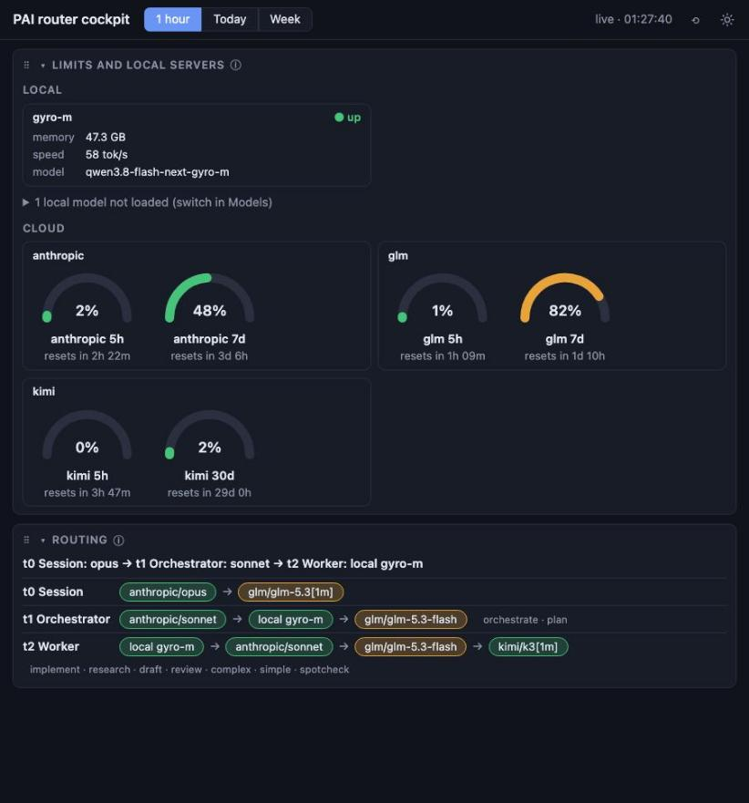
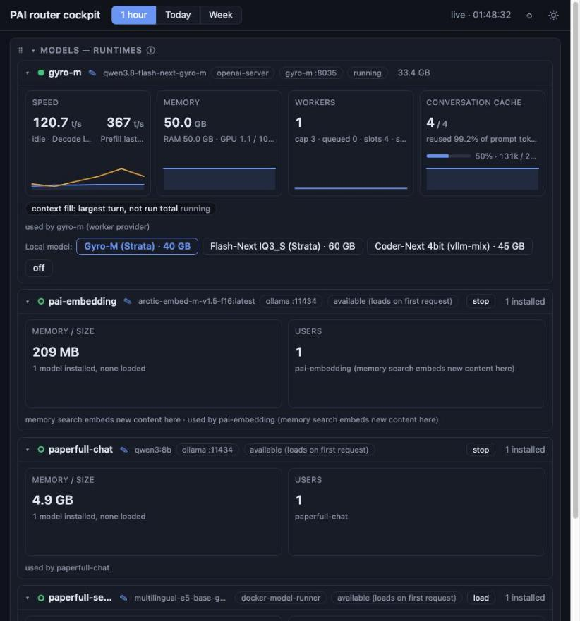
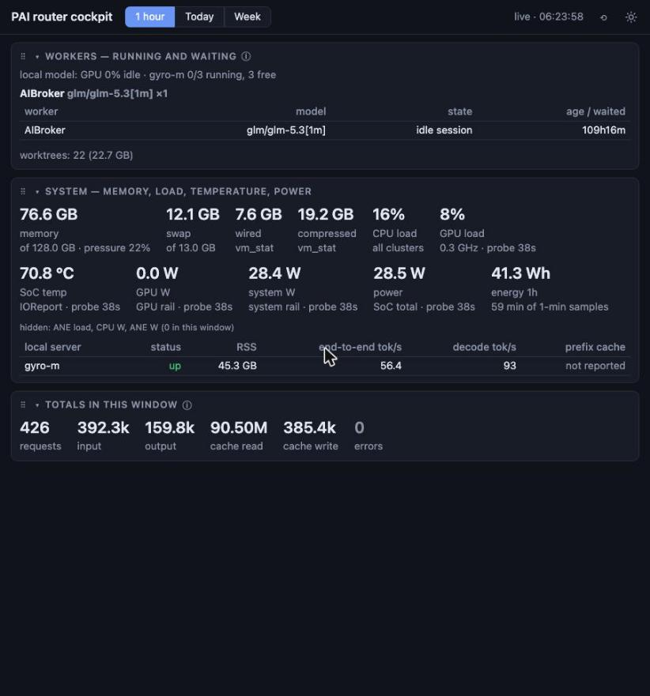
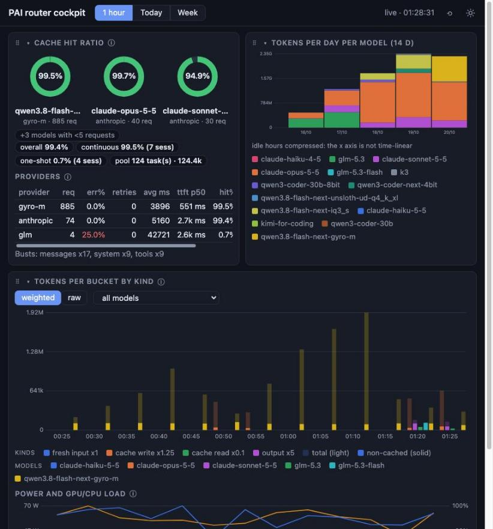

# The cockpit

The cockpit is one web page served by the [router](concepts/router.md). It answers four questions in one place: how full are my provider limits, where do delegated workers go and what are they doing, what are the local model servers and the machine doing, and where do my tokens and cache hits go. It is mostly read-only. The few controls it has start and stop local models and name them.



## Open it

Enable the router, which is off by default: `pai config set router.enabled true && pai reload`. The daemon then keeps it running, and the page is at:

```
http://127.0.0.1:8790/cockpit
```

If the Limits section shows your Anthropic gauge and the Routing section shows one row per tier, it works. An empty Totals section only means no workers have run yet.

`router.bind` is `loopback` by default, so only the machine itself can reach the page and no token is asked for. Normally you run nothing: the daemon keeps the router up. Use `pai router status` to check; the others are for when it is not:

```
pai router status      # is it up
pai router start       # start it in the background
pai router restart     # the new router takes the port, the old one drains streams
pai router stats       # the same token and cache totals in the terminal
```

Setting `router.bind` to `tailscale` (or an explicit IPv4 address) opens a second listener there, and the cockpit then needs a token: `?token=` in the URL, an `Authorization: Bearer` header, or the cookie the first token hit sets. The token is generated on first start, kept in the PAI home with mode 0600, and the full URL is printed once at startup. `0.0.0.0` is refused. See [the router](concepts/router.md) and [router command reference](commands/router.md).

The header has a **1 hour / Today / Week** switch (the window for the accounting sections), a stamp that reads "stale" when the data is older than `stampStaleSecs`, the reset-layout button and a light/dark toggle. The theme choice is kept in the browser.

## The sections, in page order

Each section is below with the title the page shows. The id in brackets is what `router.cockpit.sections` and `?sections=` take.

### Limits and local servers (`cloud`)

Answers: how much of each provider's allowance is used, and which local servers are up. Two groups: **Local** has one tile per local model server, showing up or down, memory in GB, tokens per second and the model; **Cloud** has one card per provider with a gauge per usage window (for example a five-hour and a weekly window) and its reset time. A gauge marked `estimated` is not read from the provider but derived; one marked `old` could not be refreshed and shows the age of its last reading. A provider that fails to answer shows its error in place of gauges. Limits refresh every `limitsPollMs`.

### Routing (`routing`)

Answers: where does a delegated worker go now. One line per delegation tier from `workers.yaml`, listing the models in the order they serve, each as a chip: the first available one wins, the rest are the fallback order. A local model that is not running is skipped, not started. Session-specific routes appear indented under their tier. The section is read-only. To change a route, run `pai worker route set` or edit `workers.yaml`; see [delegation tiers](concepts/delegation-tiers.md).

### Workers — running and waiting (`workers`)

Answers: what is running and what is queued behind a provider's capacity cap. Per provider, a table of running and waiting workers with their position, and for waiting ones the buttons **next** (runs next, without interrupting the running worker) and **up** (one place up). Where the queue is serial, rows can also be dragged by their grip to reorder.

### Worker pool (`pool`)

Answers: is the worker pool healthy. Its status as the pool reports it, refreshed every `poolPollMs`.

### Models — runtimes (`models`)

Answers: which local model runtimes exist, what uses them and how they are doing. One foldable card per consumer, with the model's purpose as the title (the consumer's label, else the model name) and the model id in grey beside it. Metric tiles show memory, speed, users, workers (running, queued, slots, spares) and the conversation cache, with a short sparkline of the sampler's last five minutes (`router.samples`). A value the runtime does not report shows `–`.

Controls:

- **Start / stop** buttons run the commands configured under `start` and `stop` commands of a runtime under `models.runtimes` (see [local models](concepts/local-models.md)). A runtime without a command has no button. They are the same action as `pai models start|stop`. Several consumers can share one runtime, and a stop takes the whole runtime down: on a card whose runtime serves other consumers, the stop names them ("stop ollama: also PAI embedding - click again") and needs a second click within `confirmMs`; a click after that re-arms it without acting. A runtime serving only this card's consumers stops in one click. Start and load are unaffected.
- **Local model:** a button per coding tier switches the local engine to that tier. The active tier is disabled; switching while another model runs asks for a second click and names what it stops. **off** stops every local server. Both run as a job whose progress the card follows.
- **Alias:** the pencil beside a card's title opens an inline field in place of the title, with ✓ (save), ✕ (cancel) and, when an alias is set, ↺ (back to the original name). Enter saves and Escape cancels too; tapping elsewhere cancels. An empty value removes the alias. The alias is written to `models.labels` in your config, and it then names the model in the cards, the rings and the speed table. An embedding consumer is titled by `models.embeddingLabel`.

A runtime's note (`models.runtimes.<name>.note`) is the tooltip of the runtime chip in the card header, so consumers that share a runtime do not repeat it.

A card folds by clicking its header. By default a running coding runtime is open and the rest are folded.



### System — memory, load, temperature, power (`system`)

Answers: is the machine under pressure. Tiles for memory, load, temperature and power over the selected window; a tile whose every sample is 0 is hidden and listed as "hidden". Below, a table per local server: status, memory (RSS), end-to-end and decode tokens per second, and prefix-cache hit rate.



### Totals in this window (`kpis`)

Answers: how much in all. Requests, tokens and errors over the selected 1 hour, Today or Week window.

### Tokens per bucket by kind (`tokens`)

Answers: when were tokens spent and of what kind. Stacked bars per time bucket in four kinds: fresh input, cache write, cache read and output. **weighted** counts them by price weight, **raw** counts tokens; the selector beside it narrows to one model. Under it, **Power and GPU/CPU load** uses the same buckets: watts on the left axis, load percent on a fixed 0-100 right axis.

### Cache hit ratio and Providers (`cache`)

Answers: is the cache earning its keep. **Cache hit ratio** is `cache_read / (read + write + fresh input)`, one ring per provider and model; models under `lowRequestMin` requests are folded into a chip instead. A local server that reports no cache fields per request shows its own prefix-cache counter instead, marked `*` (it covers the time since that server started, so its window differs from the router log). **Providers** is a table per provider with requests, tokens, average latency and time to first token.



### Speed per model (`speed`)

Answers: how fast is each model. Per provider and model, for the last hour and the last 24 hours: median and 90th-percentile time to first token, read speed (input tokens divided by time to first token, so prefill) and write speed (output tokens divided by decode time, replies of 16 or more tokens only).

### Cache verdict by pause (`pause`)

Answers: did the cache expire between turns. Per model, hits grouped by the pause since the previous request of the same session. A drop after five minutes means the cache expired (Anthropic's prompt cache expires after five idle minutes) and a [keepalive](cache-keepalive.md) under five minutes would have kept it.

### Sessions by tokens (`sessions`)

Answers: which sessions cost the most. The top `sessionsRows` sessions with models, requests, tokens, fresh input, output, hit percentage, cache busts, errors and last activity. A worker session carries its verdict.

### Worker runs (`runs`)

Answers: how did delegated workers end. The latest `workerRows` workers with label, provider, requests, tokens and verdict. Verdicts: **ok** and **done** in green, **report flagged** in amber (the worker finished but its report needs a look), **failed** in red; anything else is dim.

### Tokens per day per model (`daily`)

Answers: the long view. A stacked chart of tokens per day and model over the last `dailyDays` days (14 by default), with a model legend.

## Layout

The page is yours to arrange, and the arrangement survives a refresh.

- **Fold.** Every section has a chevron in its header; click it to fold the section down to its title. Cards in the Models section fold on their own. Folded state is remembered.
- **Move sections.** Drag a section by the grip at the left of its title. Drop it beside another section to share a row, or above or below to put it on its own row. A row holds up to `maxPerRow` sections (3): one fills the width, two take halves, three take thirds. A row stacks, one section per line, when the sections would each be narrower than `minSectionPx` (380); at 822 px wide a row of two stays side by side and a row of three stacks. On touch screens the drag starts only after a press of `touchPressMs` on the grip, so scrolling never drags. Near the viewport edge the page auto-scrolls (`edgeScrollPx`).
- **Move tiles.** Metric tiles inside a section have their own grip at the top right (visible on hover); drag a tile to reorder it within its section.
- **Keyboard.** Focus a grip and press Alt+Up or Alt+Down to move a section to the row above or below as its own row, Alt+Left or Alt+Right to move it within its row or out to a neighbouring row. On a tile grip, Alt+Left and Alt+Right reorder the tile. Escape cancels a drag in progress.
- **Reset.** The ⟲ button in the header discards the saved section arrangement and returns to the default.

What is stored where:

| Where | What |
|---|---|
| Browser (local storage) | Section arrangement, tile order, folded sections and cards, model colours, the weighted/raw choice, the window, the theme |
| Config | `router.cockpit.sections`, `router.cockpit.layout.*`, `models.labels`, `models.runtimes` |

Nothing about your arrangement is sent to the server, so a different browser starts from the default. The default derives from the section order and each section's width, unless `router.cockpit.layout.rows` names an arrangement.

## Configuration

### Choosing sections

`router.cockpit.sections` is a list of section ids; only those are shown, in that order. A single page load can override it:

```
http://127.0.0.1:8790/cockpit?sections=cloud,routing,pool
```

An empty list shows every section. Unknown ids are ignored, and if all are unknown the full page is shown. A section that is not on the page fetches no data. The config is re-read on every page load.

### Layout keys

`router.cockpit.layout` holds the layout policy. The values are read when the page is built, so a user override changes the served page. The shipped defaults are in `src/config/defaults/config.yaml`; [config-defaults.md](config-defaults.md) explains how defaults and overrides merge, and `pai config get router.cockpit.layout.<key> --source` shows where a value comes from.

| Key | Default | Meaning |
|---|---|---|
| `gridBreakpointPx` | 1000 | Below this width the 12-column grid's c8/c6/c4 cards go full width |
| `minSectionPx` | 380 | A row of n sections stacks when main width / n is below this |
| `maxPerRow` | 3 | Most sections in one row; a further drop beside is refused |
| `rows` | `[]` | Default arrangement as rows of section ids; empty derives it from the page order |
| `touchPressMs` | 350 | Long-press on a grip before a touch drag starts |
| `edgeScrollPx` | 40 | Distance from the viewport edge where a drag auto-scrolls |
| `gaugeMinWidthPx`, `gaugeMaxWidthPx` | 110, 120 | Width of a limits gauge tile |
| `providerTileMinPx` | 260 | Minimum column width of a provider card |
| `runtimeCardMinPx` | 420 | Minimum column width of a Models runtime card |
| `tilesWideBreakpointPx` | 720 | Card width at and above which metric tiles use `tilesWideCols` |
| `tilesWideCols`, `tilesNarrowCols` | 4, 2 | Tile columns above and below that breakpoint |
| `tilesOneColBreakpointPx` | 339 | At or below this width tiles use one column |
| `ringMinWidthPx` | 92 | Minimum column width of a cache ring |
| `palette` | 24 colours | Model colours in assignment order (`#rrggbb`); the first four are the token-kind colours |
| `colorPruneDays` | 90 | Saved model colours not used for this long are forgotten |
| `sessionTitleMaxWidthPx` | 480 | Widest title in Sessions by tokens |
| `sparkHeightPx`, `sparkViewMaxPx`, `sparkPlotHeightPx`, `sparkPlotTopPx` | 32, 100, 28, 30 | Sparkline geometry in metric tiles |
| `bigDonutSizePx`, `donutSizePx`, `donutRadiusPx`, `donutStrokePx`, `donutViewBoxPx` | 170, 84, 48, 16, 140 | Cache ring geometry |
| `tokensChartWidthPx`, `tokensChartHeightPx` | 760, 220 | Tokens per bucket chart size |
| `powerChartWidthPx`, `powerChartHeightPx` | 760, 150 | Power chart size |
| `dailyChartWidthPx`, `dailyChartHeightPx` | 520, 200 | Tokens per day chart size |
| `dailyDays` | 14 | Days in Tokens per day per model |
| `sessionsRows` | 20 | Rows in Sessions by tokens |
| `sessionsTopRows` | 10 | Sessions shown before the rest collapse into one "+N more sessions" row |
| `sessionNameMaxPct` | 35 | Session-name column cap, percent of the table width |
| `workerRows` | 15 | Rows in Worker runs |
| `lowRequestMin` | 5 | Models under this many requests become chips, not rings |
| `pollMs` | 5000 | Refresh of the main data |
| `limitsPollMs` | 30000 | Refresh of Limits and local servers |
| `poolPollMs` | 15000 | Refresh of Worker pool |
| `clockTickMs` | 1000 | Tick of the header clock |
| `stampStaleSecs` | 15 | Age after which the stamp reads "stale" |
| `jobFirstDelayMs`, `jobPollMs`, `jobMaxTries` | 2000, 5000, 120 | Following a local switch, off or runtime job: first delay, poll interval, tries |
| `serverCounterStaleSecs` | 60 | A server prefix-cache counter older than this is marked |
| `confirmMs` | 4000 | An inline confirm (a stop that also takes other consumers down) stays armed this long |
| `chartResizeSlackPx`, `chartResizeDebounceMs` | 8, 150 | Charts draw at their real pixel width, so text keeps its size; a width change above the slack redraws them, debounced |
| `foldDefaultKind` | `coding` | A Models card of this kind starts open, the rest folded |
| `gaugeWarnPct`, `gaugeBadPct` | 70, 90 | A limits gauge at/above the bad percent colours red, at/above the warn percent amber |
| `hitWarn`, `hitBad` | 0.8, 0.5 | A cache hit ratio below the warn ratio colours amber, below the bad ratio red (cache rings, pause verdicts, sessions and provider hit columns) |
| `errorWarn`, `errorBad` | 0.02, 0.1 | An error rate at/above the bad ratio colours red, at/above the warn ratio amber (totals strip, provider err%) |

The sampler behind the Models tiles is `router.samples` (`sampleMs`, `historyLen`, `engineStatusTimeoutMs`, `cardReadingMaxAgeMs`), also in the shipped defaults.
